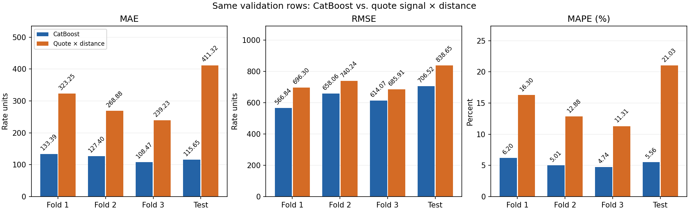
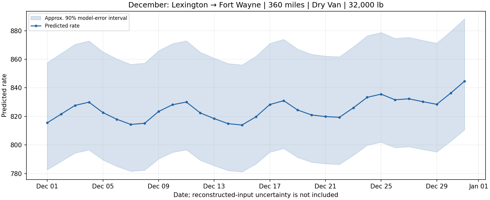

# Spotter Freight Rate Prediction

CatBoost regression for freight load prices, with chronological validation, route features, market-index decomposition and December fixed-route inference.

[Technical report (PDF)](output/pdf/freight_rate_report.pdf) · [LaTeX source](output/pdf/freight_rate_report.tex) · [Validation predictions](outputs/validation-predictions.csv) · [December predictions](outputs/december-predictions.csv)

## Results

| Metric | CatBoost | `quote_signal × distance` |
|---|---:|---:|
| Weighted 3-fold CV MAPE | 5.11% | 12.78% |
| October holdout MAPE | 5.56% | 21.03% |
| October holdout MAE | 115.65 | 411.32 |
| October holdout RMSE | 706.52 | 838.65 |

The model predicts `ln(posted_rate)` with 52 features. Three expanding temporal folds use weights `0.2 / 0.3 / 0.5`; October 18–31 is the internal holdout. The submission model refits all 48,000 labeled rows and predicts 12,000 validation loads.



## Run

Use Python 3.11 and place the four supplied assessment CSVs in `data/` as described in [data/README.md](data/README.md).

```bash
python -m venv .venv
source .venv/bin/activate
python -m pip install -r requirements.txt
jupyter lab
```

Open and run the notebooks in order:

1. [eda.ipynb](notebooks/eda.ipynb) — data quality, distributions, geography and time patterns.
2. [modeling.ipynb](notebooks/modeling.ipynb) — features, temporal CV, Optuna, diagnostics and model saving.
3. [inference.ipynb](notebooks/inference.ipynb) — load the saved model, predict validation and December, then run the scorer.

The saved model is included in `outputs/final-model/`, so inference can run without retraining. Relevant HERE routes are cached; normal runs need no API key. Load the included pickle only as part of this trusted repository and use compatible dependency versions from the model metadata.

```bash
python -m unittest discover -s tests
python notebooks/score.py \
  --predictions outputs/validation-predictions.csv \
  --december-predictions outputs/december-predictions.csv \
  --output-dir outputs/scorer_results
```

`score.py` validates file schemas, IDs and rates, then produces the required December chart. Hidden validation accuracy is calculated by the assessment organizer.

## December fixed route

Lexington → Fort Wayne, 360 miles, Dry Van, 32,000 lb, with one prediction for each December day. Missing quote values use a line fitted to three matched observations; market index uses the saved market curve plus one fitted vertical shift. The approximate 90% band transfers relative errors from the internal holdout and excludes input-reconstruction uncertainty.



## Repository

- `notebooks/` — exploration, modeling, inference, shared `utils.py` and reusable `templates.py`.
- `data/` — geographic references and active routing cache; original assessment CSVs stay local.
- `outputs/` — model, study, predictions and plots.
- `output/pdf/` — report, editable LaTeX, figure snapshots and numerical evidence.
- `scripts/build_report.py` — rebuild report figures and evidence from current artifacts.
- `tests/` — temporal splitting, optimization, market reconstruction and artifact checks.

To rebuild report figures, run `python scripts/build_report.py`. Compile the source with `pdflatex` from `output/pdf/`; the report includes its own figure snapshots. The report's narrative and tables are a dated results snapshot.

## Evaluation limits

Market curves use known train and validation input values without price targets; this is batch inference, not a strict online forecast. The holdout was reserved retrospectively after earlier exploration. Extreme-price cases remain in the metrics. Actual validation prices are unavailable, and December predictions depend on reconstructed inputs. See the report for the full methodology and limitations.
